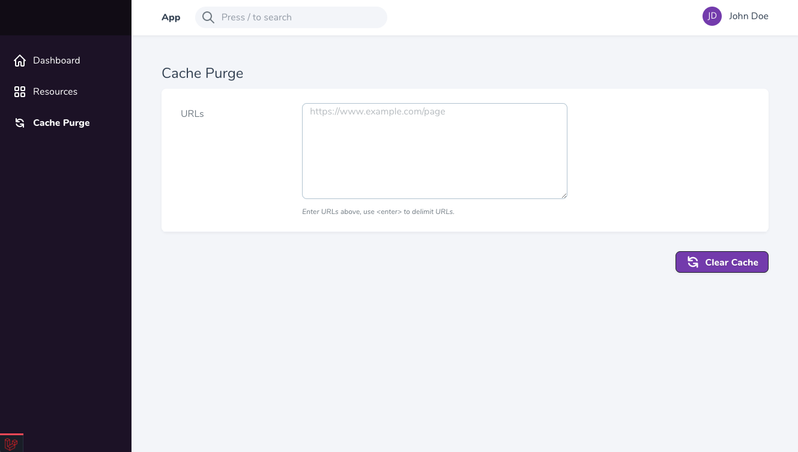
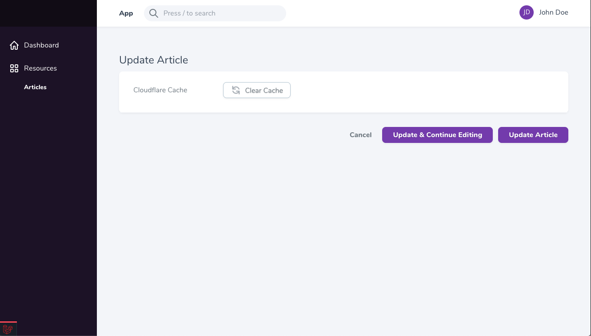

# Laravel Nova Cloudflare Tool and Field

## Features
* Laravel Nova Tool for adding a cache purge page to manually purge specific urls in batches
* Laravel Nova Field for cache purging specific urls or Cache Tags for a resource
* Option to include either the Tool, Field, or both in project
* Option to use urls, Cache Tag header, or both for purging Cloudflare cache 

##### Nova Tool:


##### Nova Field:


## Installation

* Install the package into your Laravel application. 

```console
composer require ziffmedia/laravel-cloudflare
```

* Publish the config file to your application.

```console
   php artisan vendor:publish --provider="ZiffMedia\LaravelCloudflare\CloudflareServiceProvider" --tag="config" 
```

* Provide the new config file your Cloudflare Zone and API keys in your .env files.


## Nova Tool Integration

To provide the cache purge Tool in your Nova instance, you must register the Tool with your NovaServiceProvider:

```php
// app/Providers/NovaServiceProvider.php

use ZiffMedia\LaravelCloudflare\Nova\CloudflareTool;

public function tools()
{
    return [
        // ...,
        CloudflareTool::make()
    ];
}
```

The Tool page and its purge routes run the same checks as the rest of Nova (by default, a Nova login and the
`viewNova` gate), then the Tool's `canSee`. Use `canSee` to choose who can use the Tool page and its purge routes:

```php
CloudflareTool::make()->canSee(fn ($request) => $request->user()->can('purge-cloudflare'))
```

If an app does not register `CloudflareTool`, a signed-in Nova user gets a 404 from the Tool page and the purge
routes.

The Tool page and the purge routes answer only on `cloudflare.domain` (the `CLOUDFLARE_DOMAIN` env value) when it is
set. Otherwise they use `nova.domain`, like Nova's own routes. Set `cloudflare.domain` only to a host that serves Nova.
The Tool's menu link and its purge buttons use paths on the host that loaded Nova, so on any other host they get a 404.

Note: The Tool is intended only for urls; setup for Cache Tags is not required if only using the Tool or url purging.

## Nova Action Integration

To provide the Cache Purge Action on any resource, add the Action:

```php
// app/Nova/

use ZiffMedia\LaravelCloudflare\Nova\CloudflareClearCacheAction;

public function actions(NovaRequest $request)
{
    return [
        CloudflareClearCacheAction::make()
    ];
}
```

## Cloudflare Cache-Tag Header Integration

Cloudflare has the ability to use a special Cache-Tag header on requests to purge multiple pages instantly.
If you intend to only use url purging, you can skip this step. In order to setup the Cache-Tag header,
follow the below steps:

Add the Cloudflare Cache-Tag middleware to automatically add the Cache-Tag header to all requests. Because
Cloudflare automatically removes the headers, you can use `debug_cache_tags=1` in the querystring of requests
to see the output of the header.

```php
// app/Http/Kernel.php

use ZiffMedia\LaravelCloudflare\Middleware\AddCloudflareCacheTags;

protected $middlewareGroups = [
    'web' => [
        // ...
        AddCloudflareCacheTags::class,
    ]
];
```

Add the Cloudflare controller concern to tell the page which tags to give the header request. Here is an
example implementation for an Article resource:

```php
// app/Http/Controllers/ArticleController.php

use ZiffMedia\LaravelCloudflare\Controllers\Concerns\CloudflareTaggable;

class ArticleController extends Controller
{
    public function index(Foo $foo)
    {
        cloudflare()->addResponseTaggable($foo);

        return view('foo', compact('foo'));
    }
}
```

Add the Cloudflare model concern to tell the headers which tag to use for a model. Additionally, the
`cloudflareTagsToClear` and `cloudflareTag` methods can be overwritten to allow for customization of
tags or purging of additional resources. Here is a basic example implementation for an Article model:

```php
// app/Models/Article.php

use ZiffMedia\LaravelCloudflare\Eloquent\HasCloudflareTagging;

class Article extends Model
{
    use HasCloudflareTagging;
    // ...   
}
```

## Config Options

* `purge_enabled`: Allows for purging to be turned on or off
* `auth.email` and `auth.key`: Email address and key used for authenticating with Cloudflare API
* `auth.user_service_key`: User service key, used in place of the email address and key
* `auth.token`: API token, used in place of the email address and key
* `zone`: Zone used for Cloudflare API
* `allow_header_debugging`: Includes the Cloudflare API response headers in the response
* `domain`: Domain for the Nova Tool page and the purge routes. When empty, they use `nova.domain`.

## Testing

The tests need PHP 8.3 or later and Laravel Nova. Installing Nova needs a Nova license and a Composer repository that
serves `laravel/nova`, such as nova.laravel.com. Then install and run the tests:

```console
composer install
composer test
```
